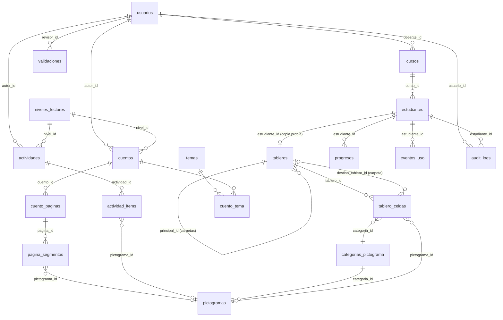

# Modelo de datos

Estado: propuesta para revisión (PLPA-57). Motor: PostgreSQL 16. Claves primarias: ULID. Marcas de tiempo: `created_at`, `updated_at`; `deleted_at` donde se indica.

## Decisiones

- Apoderados sin cuenta en el MVP: el avance lo ve la docente.
- Cuentos y actividades (nivel A: sílabas y palabras) en tablas separadas; comparten validación, progreso y eventos mediante relaciones polimórficas (`recurso_type`, `recurso_id`).
- Voz única (ElevenLabs, con Piper de respaldo): un MP3 por página o ítem, guardado en `audio_path`. No hay voz por estudiante.
- Datos de menores mínimos (Ley 21.719): sin RUT, sin fecha de nacimiento, sin foto obligatoria. El código de acceso se guarda solo como hash.

## Diagrama

## Tablas

### Acceso

| Tabla | Columnas clave | Notas |
|---|---|---|
| `usuarios` | id, nombre, email (único), password, rol (`admin`, `docente`, `revisor`), activo | Staff del liceo. Estudiantes no son usuarios. |
| `cursos` | id, nombre, anio, docente_id → usuarios | Kinder. Único (nombre, anio). |
| `estudiantes` | id, curso_id, nombre, inicial_apellido, codigo_acceso_hash, intentos_fallidos, bloqueado_hasta, tema_id, personaje, activo | Código corto de tarjeta, solo hash. Bloqueo tras 5 fallos. Índice en curso_id. |
| `audit_logs` | id, usuario_id, estudiante_id, accion, ip, created_at | "Entrar como este niño" y cambios sensibles. Solo inserción. |

### Contenido

| Tabla | Columnas clave | Notas |
|---|---|---|
| `niveles_lectores` | id, codigo, nombre, orden | A, B del prototipo. |
| `temas` | id, nombre (único) | Filtro RF-08. |
| `cuentos` | id, titulo, descripcion, portada_path, nivel_id, tipo_apoyo (`pictograma`, `texto`, `mixto`), estado (`borrador`, `en_revision`, `validado`, `archivado`), autor_id, deleted_at | Solo `validado` es visible a estudiantes (RF-13). Índices: estado, nivel_id. |
| `cuento_tema` | cuento_id, tema_id | Pivote, clave compuesta. |
| `cuento_paginas` | id, cuento_id, orden, texto, audio_path | Único (cuento_id, orden). |
| `pagina_segmentos` | id, pagina_id, orden, texto, pictograma_id (nulo) | Palabra o frase con su pictograma (RF-07). |
| `actividades` | id, titulo, tipo (`silaba`, `palabra`), nivel_id, estado, autor_id, deleted_at | Nivel A. |
| `actividad_items` | id, actividad_id, orden, texto, pictograma_id (nulo), audio_path | Un MP3 por ítem. |
| `categorias_pictograma` | id, clave, nombre, color (`aprender`, `hablar`, `colores`, `logros`, `alerta`, `info`), orden | Necesidades, emociones, personas, acciones, objetos y básicas de inicio; la docente puede crear más (PLPA-109). |
| `pictogramas` | id, palabra, categoria_id, origen (`arasaac`, `propio`), arasaac_id (nulo), imagen_path, alt_text, subido_por (nulo), activo | alt_text obligatorio (RNF-03). Propios en WebP sin EXIF. |

### Tablero de comunicación (PLPA-109)

> ⚠ **AVISO: el esquema de tableros está creado y probado, pero NO está conectado con la app.**
> Las migraciones `2026_11_11_000001` a `000003` y sus pruebas (`backend/tests/Feature/Esquema/TablerosTest.php`) existen, pero **no hay modelos ni API de tableros**, y la app sigue guardando los tableros **en el navegador** (IndexedDB), con ids de texto (`plantilla-general`, `pic-agua`, `estudiante-mateo`) que no coinciden con los ULID del servidor. La fuente de verdad sigue siendo el navegador.
>
> Para conectarlos falta, antes: (1) sincronizar **estudiantes** y **pictogramas** con el servidor; (2) subir las **fotos propias**, que hoy se guardan como dato dentro del navegador mientras `pictogramas.imagen_path` espera una ruta de archivo; (3) que los **niños inicien sesión** contra la API (hoy solo lo hace la docente), para que su tablet pueda pedir su tablero; (4) decidir cómo se sincronizan las categorías (la app tiene una lista global editable). Este esquema se diseñó para esa conexión futura y **puede necesitar ajustes** cuando se haga.

| Tabla | Columnas clave | Notas |
|---|---|---|
| `tableros` | id, nombre, es_principal, principal_id (→ tableros, solo carpetas), es_plantilla, es_general, estudiante_id (→ estudiantes), copiado_de_id (→ tableros), volver_al_elegir, creado_por (→ usuarios) | Un **principal** y sus **carpetas** forman un conjunto. Un principal es una plantilla **o** la copia de un niño. Las carpetas heredan el dueño del principal. |
| `tablero_celdas` | id, tablero_id, orden, tipo (`palabra`, `carpeta`), pictograma_id, texto_mostrado, texto_hablado, categoria_id, destino_tablero_id, es_nucleo, audio_path, audio_texto | Una palabra lleva su pictograma; una carpeta abre un tablero suyo. `audio_texto` es el texto para el que se generó `audio_path`: si el texto cambia, el audio deja de valer. |

Reglas que exige la propia base (probadas en `TablerosTest`):

- Un principal es plantilla **o** copia de un niño, nunca ambas ni ninguna; cada niño tiene **a lo más un** tablero propio y hay **una sola** plantilla general.
- Las carpetas no tienen dueño propio y solo hay **un nivel**: una carpeta no puede estar dentro de otra.
- Una palabra siempre lleva su pictograma; una carpeta siempre abre un tablero, que debe ser **suyo**; cada carpeta tiene **una sola** celda que la abre. Las carpetas y las palabras «siempre a la vista» (`es_nucleo`) solo van en el tablero principal.
- El `orden` de las celdas y el de las categorías no se repite, pero se puede **intercambiar** dentro de una transacción (restricción diferida).
- No se borra un pictograma ni una categoría que un tablero usa. Borrar un tablero se lleva sus celdas y sus carpetas; borrar la carpeta se lleva la celda que la abría; borrar al niño borra su tablero; borrar el original solo suelta `copiado_de_id` de las copias.
- `categorias_pictograma.color` sale de una paleta de 6 (`aprender`, `hablar`, `colores`, `logros`, `alerta`, `info`).

### Seguimiento y calidad

| Tabla | Columnas clave | Notas |
|---|---|---|
| `validaciones` | id, recurso_type, recurso_id, revisor_id, estado_anterior, estado_nuevo, observacion, created_at | Acta de validación (RF-13). Solo inserción. |
| `progresos` | id, estudiante_id, recurso_type, recurso_id, pagina_actual, completado, ultimo_acceso | Único (estudiante_id, recurso_type, recurso_id). |
| `eventos_uso` | id, estudiante_id, tipo (`sesion`, `lectura`, `tablero`), recurso_type (nulo), recurso_id (nulo), lugar (`liceo`, `casa`), detalle (jsonb), ocurrido_at | Base del panel y de los indicadores (RF-03, RF-09). Índice (estudiante_id, ocurrido_at). |

### Laravel

`jobs`, `failed_jobs`, `sessions`, `personal_access_tokens`, `cache`.

## Pendientes

- Definir si los eventos de más de un año se agregan o se borran.
- Confirmar con el liceo qué datos del estudiante pueden almacenarse (nombre completo o solo nombre e inicial).
