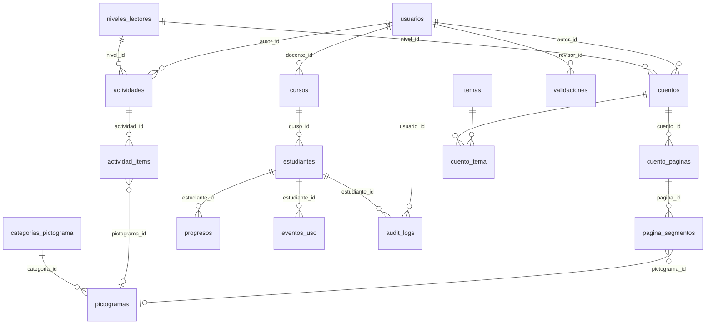

# Modelo de datos

Estado: propuesta para revisión (PLPA-57). Motor: PostgreSQL 16. Claves primarias: ULID. Marcas de tiempo: `created_at`, `updated_at`; `deleted_at` donde se indica.

## Decisiones

- Apoderados sin cuenta en el MVP: el avance lo ve la docente.
- Cuentos y actividades (nivel A: sílabas y palabras) en tablas separadas; comparten validación, progreso y eventos mediante relaciones polimórficas (`recurso_type`, `recurso_id`).
- Voz única (Piper): un MP3 por página o ítem, guardado en `audio_path`. No hay voz por estudiante.
- Datos de menores mínimos (Ley 21.719): sin RUT, sin fecha de nacimiento, sin foto obligatoria. El código de acceso se guarda solo como hash.

## Diagrama

## Tablas

### Acceso

| Tabla | Columnas clave | Notas |
|---|---|---|
| `usuarios` | id, nombre, email (único), password, rol (`admin`, `docente`, `revisor`), activo | Staff del liceo. Estudiantes no son usuarios. |
| `cursos` | id, nombre, anio, docente_id → usuarios | Kinder. Único (nombre, anio). |
| `estudiantes` | id, curso_id, nombre, inicial_apellido, codigo_acceso_hash, intentos_fallidos, bloqueado_hasta, tema_id, personaje, activo | Código corto de tarjeta, solo hash. Bloqueo tras 5 fallos. Índice en curso_id. |
| `audit_logs` | id, usuario_id, estudiante_id, accion, ip, created_at | "Entrar como este niño" y cambios sensibles. Solo inserción. |

### Contenido

| Tabla | Columnas clave | Notas |
|---|---|---|
| `niveles_lectores` | id, codigo, nombre, orden | A, B del prototipo. |
| `temas` | id, nombre (único) | Filtro RF-08. |
| `cuentos` | id, titulo, descripcion, portada_path, nivel_id, tipo_apoyo (`pictograma`, `texto`, `mixto`), estado (`borrador`, `en_revision`, `validado`, `archivado`), autor_id, deleted_at | Solo `validado` es visible a estudiantes (RF-13). Índices: estado, nivel_id. |
| `cuento_tema` | cuento_id, tema_id | Pivote, clave compuesta. |
| `cuento_paginas` | id, cuento_id, orden, texto, audio_path | Único (cuento_id, orden). |
| `pagina_segmentos` | id, pagina_id, orden, texto, pictograma_id (nulo) | Palabra o frase con su pictograma (RF-07). |
| `actividades` | id, titulo, tipo (`silaba`, `palabra`), nivel_id, estado, autor_id, deleted_at | Nivel A. |
| `actividad_items` | id, actividad_id, orden, texto, pictograma_id (nulo), audio_path | Un MP3 por ítem. |
| `categorias_pictograma` | id, nombre, orden | Necesidades, emociones, personas, acciones, objetos. |
| `pictogramas` | id, palabra, categoria_id, origen (`arasaac`, `propio`), arasaac_id (nulo), imagen_path, alt_text, subido_por (nulo), activo | alt_text obligatorio (RNF-03). Propios en WebP sin EXIF. |

### Seguimiento y calidad

| Tabla | Columnas clave | Notas |
|---|---|---|
| `validaciones` | id, recurso_type, recurso_id, revisor_id, estado_anterior, estado_nuevo, observacion, created_at | Acta de validación (RF-13). Solo inserción. |
| `progresos` | id, estudiante_id, recurso_type, recurso_id, pagina_actual, completado, ultimo_acceso | Único (estudiante_id, recurso_type, recurso_id). |
| `eventos_uso` | id, estudiante_id, tipo (`sesion`, `lectura`, `tablero`), recurso_type (nulo), recurso_id (nulo), lugar (`liceo`, `casa`), detalle (jsonb), ocurrido_at | Base del panel y de los indicadores (RF-03, RF-09). Índice (estudiante_id, ocurrido_at). |

### Laravel

`jobs`, `failed_jobs`, `sessions`, `personal_access_tokens`, `cache`.

## Pendientes

- Definir si los eventos de más de un año se agregan o se borran.
- Confirmar con el liceo qué datos del estudiante pueden almacenarse (nombre completo o solo nombre e inicial).
